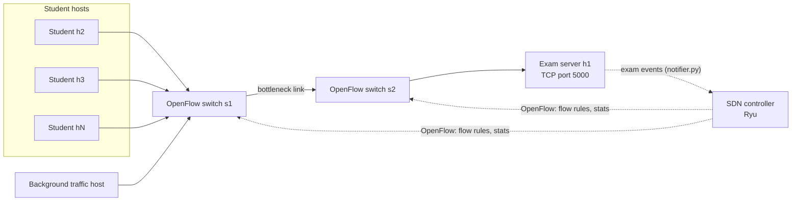

# Architecture

Owner: Member C. Last updated: wednesday.

This document describes how the Online Examination Network is put together: its components, how they communicate, and the formats the team agreed on. Details owned by other members are in `docs/protocol.md` (Member A) and `docs/sdn_design.md` (Member B).

## 1. System overview

The system is a multi-user online examination application running over an emulated Software-Defined Network.

- Students connect to an **exam server** through **TCP sockets**, receive questions, submit answers, and receive a score at the end.
- The network between students and the server is emulated in **Mininet** and is managed by an **SDN controller** using OpenFlow.
- The controller **monitors** exam traffic and **reacts dynamically**, for example by prioritizing exam flows when the network is congested.
- The project compares two network modes, a plain **baseline** and the **SDN-managed** mode, to measure what the SDN adds.

## 2. Components

| # | Component | Description | Owner | Code location |
|---|---|---|---|---|
| 1 | Exam server | Concurrent TCP server: login, question delivery, answer collection, server-side timer, scoring | A | `server/` |
| 2 | Student clients | Interactive client, and an automated client that simulates N students | A | `client/` |
| 3 | Mininet topology | Hosts, OpenFlow switches, a bottleneck link, an alternate path, background-traffic hosts | B | `topology/` |
| 4 | SDN controller | Baseline learning switch, and the exam-aware controller with traffic classification, statistics monitoring and dynamic policies | B | `controller/` |
| 5 | Integration module | Lets the exam server notify the controller of exam events | C | `integration/` |
| 6 | Experiment scripts | Generate background load, run baseline and SDN experiments, analyze logs, draw graphs | C | `experiments/` |

## 3. Architecture diagram



_The diagram above is a draft. Update it to match the final topology in `docs/sdn_design.md` (number of switches, alternate path, host names). If you prefer a drawn image, add it as `docs/architecture.png` and reference it here._

**Key points**

- Solid lines are the data path (TCP traffic). Dotted lines are control traffic.
- The **bottleneck link** is limited on purpose (bandwidth and delay set in `topo.py`), so congestion happens when background traffic runs.
- The controller talks to the switches over OpenFlow, and receives exam events from the server through the integration module.

## 4. Communication flow

A normal exam run, in order:

1. The controller starts, and the switches connect to it over OpenFlow.
2. The exam server starts on `h1` and listens on its TCP port.
3. A student client connects and sends `LOGIN`.
4. When the exam begins, the server sends an `exam_start` event to the controller through `integration/notifier.py`.
5. The controller installs a high-priority flow rule for traffic to the exam server port.
6. The server sends `QUESTION` messages, and clients send `ANSWER` messages. The server acknowledges each one.
7. During the exam, the controller polls flow and port statistics periodically and computes link utilization and per-student throughput.
8. If background traffic congests the bottleneck link, the controller applies its dynamic policy (prioritize exam flows, limit background flows, or reroute).
9. When the timer expires, the server sends `TIME_UP` to the clients and an `exam_end` event to the controller.
10. The controller removes or relaxes the exam-specific rules.
11. The server calculates scores and sends `RESULT` to each student.

## 5. Baseline mode vs SDN mode

| | Baseline mode | SDN mode |
|---|---|---|
| Controller | `baseline_controller.py` (plain learning switch) | `exam_controller.py` |
| Knows about exam events | No | Yes (receives events from the server) |
| Traffic classification | None, all traffic treated equally | Exam traffic identified by port and prioritized |
| Monitoring | None | Periodic flow and port statistics |
| Reacts to congestion | No | Yes (dynamic policies) |

Both modes are started with the same topology script (`--mode baseline` or `--mode sdn`) and are run with identical experiment settings, so the results are directly comparable.

## 6. Agreed formats

These formats were agreed by Members A, B and C. **Do not change them without telling the whole team**, because `notifier.py`, the controller and `analyze.py` all depend on them.

### 6.1 Exam event message (server to controller)

Sent by `integration/notifier.py`, received by `controller/rest_api.py`.

```json
{
  "event": "exam_start",
  "timestamp": "2026-11-05T10:30:00.123",
  "student_count": 10,
  "server_port": 5000
}
```

| Event name | Sent when |
|---|---|
| `exam_start` | The exam begins |
| `exam_end` | The timer expires or all students have submitted |
| `student_joined` | A student logs in |
| `student_left` | A student disconnects or finishes |

_Final event names are defined in `docs/protocol.md` (Member A). Update this table if they change._

### 6.2 Application log format (server and clients)

CSV, one line per event, written to `logs/`.

```
timestamp,student_id,event,detail
2026-11-05T10:30:01.250,s03,QUESTION_SENT,q1
2026-11-05T10:30:01.310,s03,ANSWER_RECEIVED,q1
```

- `timestamp`: ISO 8601 with milliseconds, same style everywhere.
- `student_id`: the student ID, or `server` for server-wide events.
- `event`: one of `LOGIN`, `QUESTION_SENT`, `ANSWER_RECEIVED`, `TIME_UP`, `RESULT_SENT`, `DISCONNECT`, ...
- `detail`: question ID or other extra information.

### 6.3 Controller statistics format

CSV, one line per polling interval, written by `controller/stats_monitor.py`.

```
timestamp,link,utilization_pct,exam_bytes,background_bytes
2026-11-05T10:30:02.000,s1-s2,64.2,182340,905120
```

### 6.4 Experiment output

Each run of `experiments/run_experiment.sh` saves its logs in `results/raw/` under a folder named after the run:

```
results/raw/<mode>_<students>students_<load>load_<run-number>/
```

for example `sdn_10students_heavyload_1/`. `analyze.py` reads these folders and writes graphs to `results/graphs/`.

## 7. Interfaces between the components

| From | To | Mechanism | Defined in |
|---|---|---|---|
| Client | Server | TCP sockets, application protocol messages | `docs/protocol.md` |
| Server | Controller | Exam event message (6.1), sent by `notifier.py` | this document |
| Controller | Switches | OpenFlow 1.3 | `docs/sdn_design.md` |
| Experiment scripts | All components | Start and stop commands, log collection | `README.md` section 6 |

### Open decision: how the server reaches the controller

Each Mininet host has its own network namespace, so `127.0.0.1` inside the server host does **not** point to the controller. Member B and Member C choose one approach:

1. A NAT or root-namespace interface added in `topology/topo.py`, so hosts can reach the controller at a known address.
2. The controller infers exam start and end from the TCP traffic itself, without explicit events.

**Decision:** _to be filled in once agreed (date, chosen option, address)._

## 8. Experiment design

| Variable | Values |
|---|---|
| Network mode | baseline, SDN |
| Number of students | 3, 6, 10 |
| Background load | none, medium, heavy |
| Repetitions | 3 per combination |

**Metrics:** response time per question, answer-submission latency, throughput, packet loss, link utilization, fairness across students (Jain's index).

**Challenging scenarios (at least one):** heavy congestion during the exam, link failure with rerouting, many concurrent students.

## 9. Limitations

_Fill in at the end, for example:_
- The network is emulated in Mininet, not a physical network.
- Traffic is not encrypted.
- The question bank is small.
