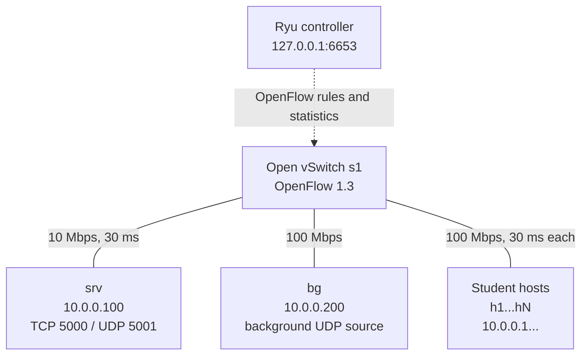

# Architecture

Owner: Member C. Updated: 2026-11-18.

This document records the architecture visible in the current source files. The application protocol is owned by Member A (`docs/protocol.md`); detailed OpenFlow/controller design is owned by Member B (`docs/sdn_design.md`). This document does not replace those specifications.

## 1. System overview

The project combines a multi-user TCP online examination application with an emulated Software-Defined Network.

- Student clients connect to the examination server using TCP.
- The server authenticates student IDs, sends questions, receives answers, enforces an exam timer and returns results.
- Mininet creates the virtual network. Open vSwitch `s1` forwards packets using OpenFlow 1.3 rules.
- Ryu runs the controller application in `controller/trustme.py`.
- In SDN mode, the controller monitors the server-facing link and can rate-limit the heaviest sender when utilization reaches the configured threshold.
- The experiment scripts generate controlled background traffic and collect client/controller output so baseline and SDN runs can be compared.

## 2. Components and ownership

| Component | Responsibility | Owner | Source location |
|---|---|---|---|
| Exam server | Concurrent TCP sessions, login, questions, answers, timer and score | A | `server/` |
| Student clients | Interactive student and concurrent automated students | A | `client/` |
| Mininet topology | Creates switch, server, background host, student hosts and links | B | `topology/topology.py` |
| SDN controller | Learning switch, port-statistics polling, congestion detection and meter-based limiting | B | `controller/trustme.py` |
| Notifier | Sends exam lifecycle/student events by HTTP POST | C | `integration/notifier.py` |
| Dummy listener | Receives notifier POSTs for isolated testing | C | `integration/test_listener.py` |
| Experiment scripts | Background load, automated run orchestration and result analysis | C | `experiments/` |
| Configuration/results/docs | Shared settings, raw results, graphs and project documentation | C | `config.json`, `results/`, `docs/` |

## 3. Current topology

The source of truth is `topology/topology.py`. It creates one switch named `s1`, a server host `srv`, a background host `bg`, and a configurable number of student hosts `h1` through `hN`.

| Host | Purpose | IP | Switch port | Link bandwidth | Delay configured |
|---|---|---|---:|---:|---|
| `srv` | Exam server and iperf receiver | `10.0.0.100/24` | 1 | 10 Mbps | 30 ms |
| `bg` | UDP background traffic source | `10.0.0.200/24` | 2 | 100 Mbps | Not specified |
| `h1` | Student client host | `10.0.0.1/24` | 3 | 100 Mbps | 30 ms |
| `h2` | Student client host | `10.0.0.2/24` | 4 | 100 Mbps | 30 ms |
| `h3` to `hN` | Student client hosts | `10.0.0.3/24` onward | 5 onward | 100 Mbps | 30 ms |

The topology accepts `--students` (default 10, maximum 99). The host-to-switch port numbering follows `addLink` order. `srv` must remain the first host link so that its switch port stays at 1, as assumed by the controller.



All host traffic destined for `srv` crosses the 10 Mbps `s1`–`srv` link. This link is the project's bottleneck. There is one switch and no alternate path; rerouting after link failure is not part of the current implementation.

## 4. Service ports and communication interfaces

| Port | Protocol | Use |
|---:|---|---|
| 6653 | TCP | OpenFlow connection from `s1` to Ryu |
| 5000 | TCP | Student-to-exam-server connection |
| 5001 | UDP | iperf background-traffic receiver on `srv` |
| 8080 | HTTP/TCP | Notifier destination configured in `config.json`; no receiver endpoint is present in `trustme.py` |
| 8081 | HTTP/TCP | Default local dummy-listener port for notifier testing |

### Client to server

The clients and server exchange UTF-8 newline-delimited JSON messages over TCP. Message details belong to Member A's `docs/protocol.md`.

### Controller to switch

The Ryu controller and Open vSwitch use OpenFlow 1.3. The controller installs flow entries and a meter and requests port statistics.

### Server to controller event notification

`integration/notifier.py` constructs a JSON event with a timestamp and sends it by HTTP POST to:

```text
http://<controller_ip>:<controller_rest_port>/exam/event
```

The current `controller/trustme.py` does not implement an HTTP `/exam/event` endpoint. The default `controller_ip` in `config.json` is a placeholder (`10.0.0.254`). Therefore the notifier's HTTP transport can be tested with the dummy listener, but end-to-end server-to-controller event delivery is not complete in this source snapshot. The notifier catches failures so the exam server is not supposed to fail solely because notification is unavailable.

## 5. Startup and runtime sequence

1. Start Ryu using `controller/trustme.py`, listening for OpenFlow on TCP port 6653. Set `EXAM_MODE=sdn` or `EXAM_MODE=baseline` before starting the process.
2. Start `topology/topology.py`. The switch `s1` connects to the controller.
3. The topology creates `srv`, `bg`, and `h1` through `hN` and starts the network.
4. The topology automatically starts `server/server.py` on `srv` at TCP port 5000.
5. The topology automatically starts an iperf UDP receiver on `srv` at port 5001.
6. Student clients connect to `10.0.0.100:5000`, send `LOGIN`, receive `START` and `QUESTION`, submit `ANSWER`, receive `ACK`, and eventually receive `RESULT` or `TIME_UP`.
7. The background host runs `experiments/traffic_gen.sh` to offer none, medium or heavy UDP load to `10.0.0.100:5001`.
8. The controller requests port statistics at its two-second polling interval. It derives the server-link rate from the delta of transmitted byte counters.
9. At or above 80% utilization of the 10 Mbps server link, SDN mode selects the heaviest eligible sender and installs a meter-controlled flow for its IPv4 traffic to the server.
10. Experiment outputs are saved per run and processed by `experiments/analyze.py`.

## 6. Baseline mode versus SDN mode

Both modes use the same controller source, `controller/trustme.py`. The mode is selected by the `EXAM_MODE` environment variable, not by the topology's `--mode` argument (which the current topology accepts but ignores).

| Behavior | Baseline (`EXAM_MODE=baseline`) | SDN (`EXAM_MODE=sdn`) |
|---|---|---|
| Table-miss rule | Yes | Yes |
| MAC learning and learned flows | Yes | Yes |
| Port-statistics polling | Yes | Yes |
| Controller statistics CSV | Yes | Yes |
| Exam-specific TCP priority-20 flow | No | Yes |
| Congestion-triggered sender meter flow | No | Yes |

In both modes the controller can log congestion statistics. Only SDN mode calls the rate-limit reaction when the threshold is reached.

## 7. Current controller parameters visible in source

| Parameter | Current value | Meaning |
|---|---:|---|
| `LINK_MBPS` | `config.json` value, currently 10 | Capacity of server-facing link |
| `SERVER_PORT` | 1 | Switch port connected to `srv` |
| `EXAM_PORT` | 5000 | TCP examination port |
| `POLL_INTERVAL` | 2 seconds | Port-statistics poll interval |
| `THRESHOLD_PCT` | 80 | Congestion threshold |
| `EXAM_PRIORITY` | 20 | Exam-specific TCP flow priority in SDN mode |
| `LIMIT_PRIORITY` | 10 | Rate-limit flow priority |
| Learned flow priority | 1 | MAC-learning forwarding flow |
| Table-miss priority | 0 | Sends unmatched packets to controller |
| `LIMIT_KBPS` | 2000 | Meter rate, 2 Mbps |
| `LIMIT_SECONDS` | 30 | Hard timeout of the rate-limit flow |
| `MIN_SENDER_MBPS` | 1.0 | Minimum sender input rate considered |

The exam-specific match is IPv4 TCP traffic whose destination is `SERVER_IP` and TCP destination port is `EXAM_PORT`. The rate-limit flow matches IPv4 packets entering from the selected switch port and destined for `SERVER_IP`; it attaches meter ID 1 and outputs to server port 1. The exam flow's priority 20 is higher than the limit flow's priority 10.

## 8. Log formats and experiment outputs

### Client events

The current `client/client.py` writes one combined file named `client_events.csv` in the supplied results directory. Its header is:

```csv
timestamp,student_id,event,question_id,details
```

The client currently records `ANSWER_SENT` and `ACK_RECEIVED` events. Timestamps are UTC strings with fractional seconds and a trailing `Z`. Answer latency is paired by `student_id` and `question_id`.

### Server log

The current `server/server.py` writes plain-text `server.log` in its process working directory. It is not a CSV file. It records system and student events such as exam start/end, connection establishment, student join/leave, answer submission and time-up.

### Controller statistics

The current controller writes the following CSV header to the path in `STATS_CSV` (or `controller_stats.csv` in its current working directory if the environment variable is not set):

```csv
timestamp,srv_link_mbps,utilization_pct,congested,limited_ports
```

The timestamp currently has second precision. `limited_ports` is written as a semicolon-separated list, or an empty string when no ports are limited.

### Run folder naming

The experiment runner creates one folder per run:

```text
results/raw/<mode>_<N>students_<load>load_<run-number>/
```

For example:

```text
results/raw/sdn_5students_heavyload_1/
```

Expected files include `client_events.csv`, `controller_stats.csv`, `controller.log`, `topology.log`, `auto_client.log`, `traffic_sender.log`, `iperf_receiver.log`, `run_info.txt`, and the server log when available.

## 9. Experiment design

The core comparison holds student count, load level, duration and topology constant while changing only `EXAM_MODE`.

| Variable | Values |
|---|---|
| Mode | `baseline`, `sdn` |
| Students | 3, 6, 10 are useful comparison points; topology supports 1–99 |
| Background load | `none`, `medium`, `heavy` |
| Medium offered load | Approximately 5 Mbps (half of the 10 Mbps bottleneck) |
| Heavy offered load | Approximately 20 Mbps (twice the bottleneck capacity) |
| Repetitions | At least 3 per condition for a more reliable comparison |

Metrics produced by the analyzer include mean answer latency, P95 answer latency, Jain's fairness index based on reciprocal per-student mean latency, mean server-link utilization and percentage of controller samples marked congested. iperf logs provide supporting background-traffic sender/receiver measurements; the current analyzer does not convert iperf output into a packet-loss metric.

## 10. Decisions and limitations

| Item | Current state |
|---|---|
| Server host and address | Confirmed by topology: `srv`, `10.0.0.100`, switch port 1 |
| Background host | Confirmed by topology: `bg`, `10.0.0.200`, switch port 2 |
| Topology script | `topology/topology.py` |
| Controller script | `controller/trustme.py` |
| Baseline selection | `EXAM_MODE=baseline` using the same controller file |
| SDN selection | `EXAM_MODE=sdn` using the same controller file |
| Notifier endpoint | Not implemented by current controller source; `/exam/event` is only the notifier's target path |
| Controller address reachable from `srv` | Not finalized; `10.0.0.254` in config is a placeholder |
| Alternate path/rerouting | Not implemented; topology has one switch and one route to the server |
| Question-bank file | `server/questions.json` is empty in the supplied snapshot; check with Member A |

## 11. Ownership boundary

Member C owns this architecture document. `docs/protocol.md` is maintained by Member A and `docs/sdn_design.md` by Member B. If an interface or controller behavior changes, agree with the relevant owner and update the corresponding owned document rather than silently editing another member's file.
